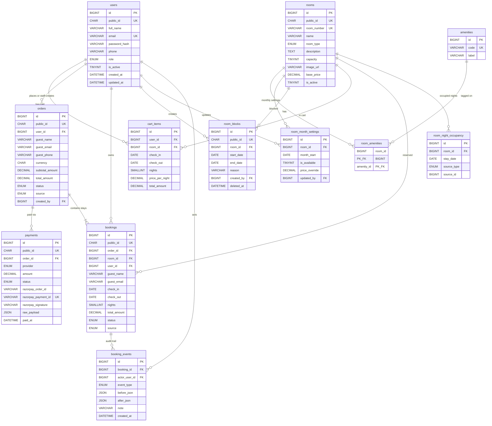

# Hotel OS — ER diagram

PostgreSQL entity-relationship diagram for [`../db/schema.sql`](../db/schema.sql).

## Full ERD

## Domain groups

| Domain | Tables |
|---|---|
| Auth | `users` |
| Inventory | `rooms`, `amenities`, `room_amenities` |
| Admin | `room_month_settings` |
| Manager | `room_blocks` |
| Customer cart | `cart_items` |
| Checkout / payments | `orders`, `payments`, `bookings` |
| Audit | `booking_events` |
| Availability lock | `room_night_occupancy` |

## Cardinality highlights

- One **order** → many **bookings** (multi-room cart checkout)
- One **order** → many **payments** (retries / partials; usually one captured Razorpay payment)
- One **room** + one **stay_date** → at most one **room_night_occupancy** row (prevents double booking)
- **rooms** ↔ **amenities** via **room_amenities** (M:N)
